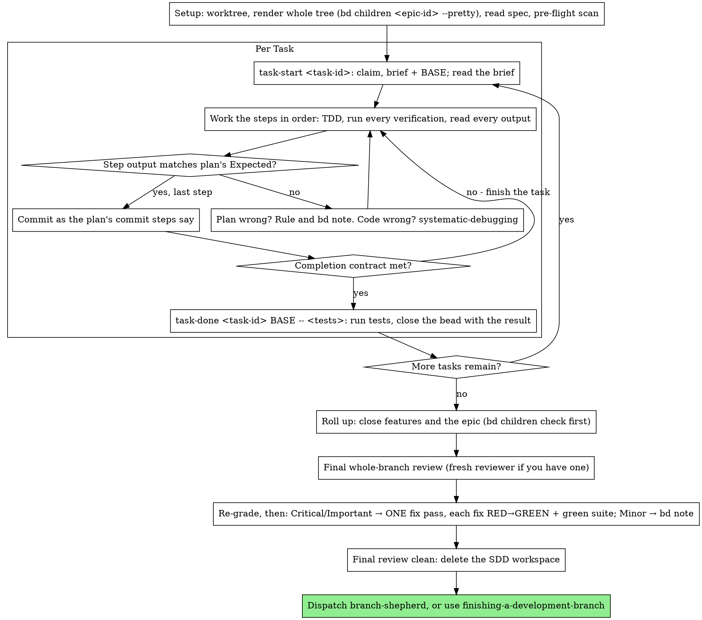

# Executing Plans

Execute the plan yourself, task by task, in this session: no implementer
subagent per task, no reviewer per task. One fresh-context review of the
whole branch at the end.

**Why native:** Subagent-driven development pays for a fresh implementer
and a fresh reviewer on every task, each re-reading the codebase from zero.
Native execution pays for one context (yours) plus one reviewer at the end.
What it gives up is a fresh context per task and a second pair of eyes per
task. This skill keeps what those two things bought, by other means: the
brief is the spec, bd is your memory, TDD is the per-task gate, and the
final reviewer is the second pair of eyes.

**Core principle:** The plan already did the thinking. Execute it exactly,
prove each step with a test you watched fail and then pass, and leave a
record in bd that survives your own forgetting.

**Narration:** between tool calls, narrate at most one short line — bd and
the tool results carry the record.

**Continuous execution:** Do not pause to check in with your human partner
between tasks. They chose native execution to spend less, not to answer
"should I continue?" after every task. Execute all tasks from the plan
without stopping.

**Rulings, not stalls.** Conflicts, ambiguities, plan defects — decide them.
The spec is the binding authority, the plan is its argument, and your
judgment settles what neither answers. Record every decision as
`bd note <task-id> "Ruling: <what you decided> — <why> — <what it costs if
wrong>"` (epic-level rulings go on the epic), and keep going. Deviating from
the plan without a recorded ruling is a decision made in secret.

Four things stop you, and only these: an irreversible or destructive
operation; a security-sensitive action; a side effect outside this worktree
that norms say you ask about first (a merge, a push to a shared branch, a
publish); and a plan so broken that every path forward is a guess. For
those, stop and ask.

## When to Use

- You have a bd hierarchy from writing-plans and your human partner chose
  native execution at the handoff.
- Your harness has no subagent tool. Never fabricate a dispatch; run the
  plan here.
- Tasks are mostly independent — the same precondition as
  subagent-driven-development.

A fully specified plan makes native execution transcription plus testing:
it runs well on a mid-tier session model, and the one place the most
capable model earns its cost is the final review, which this skill
dispatches separately. Tell your human partner so when they choose native.

Prefer subagent-driven-development when your human partner wants a review
gate on every task, or when the plan is long enough that its later tasks
would run on a compacted context. Native execution over a long plan still
works — bd is what makes it recoverable — but the last tasks get the least
of you.

## The Process



## Setup

Ensure the work happens in an isolated workspace: use using-git-worktrees
to create one or verify the existing one. Never start implementation on a
main/master branch without your human partner's explicit consent.

Conversation memory does not survive compaction. A native executor that
loses its place re-implements tasks whose commits already exist — the same
failure as a controller re-dispatching them, paid for in your own context.
Durable progress rides on bd, not on todos: harness todos are a live view;
bd is the record. The workspace, brief files, and bd conventions are shared
with subagent-driven-development, so a plan can change executors mid-flight
and the new one resumes from the same state.

- Reload the hierarchy with `bd children <epic-id> --pretty` at skill start
  and after any compaction. It renders the WHOLE tree at every depth, closed
  issues included, with a `Total: N issues` footer; `--json` returns one
  level and is for per-issue detail, never for learning the tree's shape.
- Tasks bd shows `closed` are DONE — do not redo them; resume at the first
  task not `closed`. Their commits exist in git even when your context no
  longer remembers making them: after compaction, trust `bd show`,
  `bd children`, and `git log` over your own recollection.
- Every ruling and deferral is a `bd note <task-id> "..."`; closing carries
  the commit range and test result as the reason (`task-done` writes it).
- The `.joe-bag-of-tricks/sdd/` workspace (briefs, test logs, review
  packages) is disposable scratch; `git clean -fdx` destroying it costs
  nothing — bd and git are the only durable state.

Read the epic once — its description, Global Constraints, and Review Focus —
and create a todo per task. If the epic names a spec (`--spec-id`, the
living design doc), read that too: the spec is the authority the plan
argues from, and conflicts inside the plan resolve against it. An epic with
no reachable spec gets a `bd note` saying so — rulings made without one are
provisional.

**REQUIRED SUB-SKILL:** load test-driven-development now, before the first
task. It governs every step of every task below; a design whose steps
already say "write the failing test first" does not exempt you from
reading it.

Before the first task, scan the hierarchy for conflicts between tasks. The
tasks' Interfaces blocks tell you where to look: for every task that
consumes what an earlier task produces, one row — the two tasks, what one
produces against what the other consumes, and what you found. Tasks that
share nothing get no row; a plan whose tasks share nothing gets the single
line `Pre-flight: no shared interfaces`. Rule on each conflict a row
surfaces with the spec as the binding authority, record the scan and its
rulings as one `bd note` on the epic, and start the first task. Each task's
own text is checked when you read its brief, not here.

## The Task Loop

Everything you print, and every tool result, stays resident in your
context for the rest of the session. Redirect long test output to a file
in the workspace and read its tail; read a brief, not the whole hierarchy.

### 1. Take the task

- Run this skill's `bash scripts/task-start <task-id>`. It claims the bead,
  extracts the brief, and prints the brief path and BASE (the commit the
  task's range is cut from) in one call. Read the brief for every task,
  including ones you remember from setup: what you remember is a summary,
  the brief has the exact values, signatures, and test cases.
- Mark the task's todo in_progress.

Every tool call is a turn that re-reads your whole context. Bookkeeping
rides along with work — a `bd note` in the same call as the commit, never
in a call of its own.

### 2. Work the steps

The design's steps are already in RED-GREEN order; follow them in that
order under test-driven-development, loaded at setup. A test step's code
is written first and run first. Watching it fail is a step, not a
formality — a test that passes before the implementation exists is a
finding about the test.

Every step that runs a command has an `Expected:` line. Run the command,
read its output, and compare. Three outcomes:

- **Matches.** Next step.
- **The code is wrong.** Use systematic-debugging. Find the cause; never
  patch the symptom to make the step's output match.
- **The plan is wrong** — a step contradicts the spec, an interface from an
  earlier task doesn't match what this task consumes, a command that
  cannot work. Rule on the smallest change that satisfies the spec, record
  it as `bd note <task-id> "Ruling: <finding> — <what you decided and
  why>"`, and continue. The ruling is carried, not remembered: later tasks
  that touch the same interface read it from bd.

Commit as the design's commit steps say. A task that spans several commits
is fine; BASE is what the review range is cut from, never `HEAD~1`.

### 3. The completion contract

Before a task closes, all of the following are true, with evidence in this
session — not inferred from the diff looking right:

- Every test the brief names exists and ran in this task, and you read
  the output.
- The final test run for the task passed — `task-done` is that run, and
  it writes the command and result into the close reason.
- Every `Expected:` line in the brief was compared against real output.
- Every deviation from the brief has a `Ruling:` note on the bead.

**REQUIRED SUB-SKILL:** verification-before-completion governs the claim.
If any item is missing, the task is not complete: finish it.

### 4. Complete the task

Run this skill's `bash scripts/task-done <task-id> BASE -- <test command>`
with the test command the brief names for the whole task. It runs the
tests, keeps the full output in the workspace, prints the tail, and — only
if they pass — closes the bead with the record as its reason:

`commits <base7>..<head7>, tests: <command> → <result>`

A failing run records nothing; the task is not complete. When it closes,
mark the todo complete and take the next task.

### 5. Roll up the hierarchy

When every task under a feature is closed, close the feature; when every
feature is closed, close the epic. Run `bd children <id>` before every
parent close and refuse while any row is not `✓` — `bd close` accepts a
parent over open children silently, and a closed parent hides unfinished
work.

## Final Review

Run `bash ../subagent-driven-development/scripts/review-package MERGE_BASE HEAD`
(MERGE_BASE = the commit the branch started from, e.g.
`git merge-base main HEAD`) and review from the file it prints.

**With a subagent tool:** dispatch the reviewer on `model: "fable"` (top
tier; if Fable is not in this session's roster, use the top tier that is)
— the whole-branch review is a judgment task — using
requesting-code-review's
[code-reviewer.md](../requesting-code-review/code-reviewer.md), with the
package path, the epic ID and spec path, the epic's Review Focus verbatim
if it has one (the input classes and failure modes the plan's tests do not
exercise — the reviewer checks each deliberately), and a pointer to the
`Ruling:` notes on the closed tasks so it can weigh the calls you made.
Specify the model explicitly; an omitted model inherits the session's,
which may not be the most capable. This is the one fresh context the whole
run buys. Do not skip it, and do not replace it with your own read of the
diff.

**Without a subagent tool:** read code-reviewer.md and perform that review
yourself against the package, as a separate pass after the last task
closes. Record `bd note <epic-id> "Final review: self-review (no subagent
tool)"`, and say so in your final message: a self-review by the author is
weaker than a fresh reviewer, and your human partner decides whether that
is enough before merge.

Sort the findings before you act on any of them. The reviewer's severity
labels are advice; the gate is yours. Its "Declined to judge" list is
yours too: every line there is a ruling you make and record, exactly like
a plan conflict — `bd note <epic-id> "Final: Ruling: <behavior the
reviewer set aside> — <what a reasonable person using this software gets,
and why that stands or why it is now a finding> — <cost if wrong>"`.
Re-grade first, by effect: the spec is a vision document, and a finding's
grade is what a reasonable person using this software gets if it ships,
not whether the spec names the input that triggers it — a reviewer who
set a finding at Minor because the spec was silent has graded the spec,
not the effect. Then:

- **Critical and Important** enter the fix pass.
- **Minor** goes on the epic as `bd note <epic-id> "Final: minor
  (deferred): <one-liner>"` and to your final message under "Deferred
  minors". Minors never enter the fix pass, and never become rulings — a
  ruling is a decision about a conflict, not a note that you declined a
  polish suggestion.

Fix the Critical and Important findings yourself — you are the
implementer here — in ONE pass. Each fix is verified by TDD, not by a
second reviewer: write the test that reproduces the finding, watch it
fail, make it pass, then run the whole suite. Record each as `bd note
<epic-id> "Final: fixed <finding> — <test name> RED→GREEN, suite <N>/<N>"`.
A fix without a test that failed first is not verified; a suite that is
not green after the pass means the pass is not over. Do not dispatch a
re-review: it would re-read a diff whose covering tests already answer
"addressed" and whose suite run already answers "broke nothing".

A finding you decide not to fix is a ruling — `Final: Ruling: <finding> —
<why the code stands> — <cost if wrong>` — and reaches your human partner
in the rulings list. There is no second fix pass.

## Finish

Before you delete anything, collect every `Ruling:` note from bd — walk
the epic's hierarchy and read the notes on the epic and each closed task —
into your final message under "Rulings I made", in the order you made
them, each with what it costs if wrong, and every `minor (deferred)` note
under "Deferred minors". Both lists are exhaustive. Your final message is
the only place the decisions you took on your human partner's behalf — and
the findings you chose not to act on — reach them.

When the final review is clean and its fixes are committed, delete the SDD
workspace (`rm -rf "$(git rev-parse --show-toplevel)/.joe-bag-of-tricks/sdd"`)
— bd and git history are the record now.

Then deliver the branch the way subagent-driven-development does: dispatch
the `joe-bag-of-tricks:branch-shepherd` agent with this one branch in the
background, or use finishing-a-development-branch directly for
interactive, step-by-step delivery.

## Common Rationalizations

| Excuse | Reality |
|--------|---------|
| "I remember what the task says" | You remember a summary. The brief has the exact values. Read it. |
| "The plan's code is right, skip watching the test fail" | A test you never saw fail proves nothing. It is one step. Run it. |
| "I'll run the full suite at the end instead of per step" | Per-step runs are how you learn which step broke it. The end-of-task run is the contract, not a substitute. |
| "The plan is wrong here, I'll just do the right thing" | Do the right thing and record the ruling. An unrecorded deviation is a decision made in secret. |
| "I'll close the beads after a few tasks" | Compaction does not wait for a convenient moment. `task-done` closes the bead in the same call as the test run. |
| "Let me check in before the next task" | They chose native to spend less. Progress prompts spend their time instead. Only the four stops stop you. |
| "I read my own diff carefully; the final reviewer is redundant" | Same author, same blind spots. The reviewer is the only fresh context this run buys. |
| "Tests should pass, the change was trivial" | "Should" is not evidence. The contract requires the command and its output. |
| "Subagents are slow and expensive, I'll skip the final review too" | Native already removed the per-task reviewers. One review of the whole branch is the floor, not the ceiling. |
| "The reviewer said Minor, so it's Minor" | The label graded the spec's silence. Grade what the person gets. Re-grade, then gate. |
| "The fix is obvious, no need for a failing test first" | The failing test is the only proof the finding was real and is now gone. Without it you have a diff and a hope. |
| "I'll fix the minors too while I'm in there" | Every minor you fix is a test, a fix, and a suite run your partner did not ask for. Note them; your partner decides. |

## Example Workflow

```
You: I'm using the executing-plans skill to implement this plan natively.

[Setup: worktree verified]
[bd children epic-42 --pretty: 2 features, 3 tasks, none closed; spec read]
[Pre-flight scan: 1 shared-interface row, clean; bd note on epic-42]
[Create todos for all tasks]

Task epic-42.1: Hook installation script

[bash scripts/task-start epic-42.1 → brief read; BASE a1b2c3d]
[Step 1: write failing test — written]
[Step 2: run it — FAIL: install_hook not defined. Matches Expected.]
[Step 3: implement — written]
[Step 4: run it — PASS 1/1. Matches Expected.]
[Step 5: commit — d4e5f6a]
[Contract: tests ran, output read, no deviations]
[bash scripts/task-done epic-42.1 a1b2c3d -- npm test -- hooks → closed: commits a1b2c3d..d4e5f6a, tests: npm test -- hooks → 1/1 pass]

Task epic-42.2: Recovery modes

[bash scripts/task-start epic-42.2 → brief read; BASE d4e5f6a]
[Step 2: run failing test — FAIL, but on an import error: task .1 exported
 installHook, brief consumes install_hook]
[Ruling: brief's consumer name is a typo against .1's Produces block;
 use installHook — bd note epic-42.2 "Ruling: install_hook → installHook — matches .1 Produces — cost if wrong: one rename"]
[Steps 2-5 as planned; commit b7c8d9e]
[bash scripts/task-done epic-42.2 d4e5f6a -- npm test -- recovery → closed: commits d4e5f6a..b7c8d9e, tests: npm test -- recovery → 8/8 pass]

...

[Roll up: bd children shows every task ✓; close features, close epic-42]
[review-package MERGE_BASE HEAD; dispatch code-reviewer, model fable]
Reviewer: One Important finding — progress reporting interval hardcoded. Two Minor.
[Re-grade: Important stands; minors → bd note on epic-42 as deferred]
[Fix pass: test_progress_interval_configurable RED → extract PROGRESS_INTERVAL → GREEN; suite 12/12; commit]
[bd note epic-42 "Final: fixed hardcoded interval — test_progress_interval_configurable RED→GREEN, suite 12/12"]

Rulings I made:
- epic-42.2: install_hook → installHook (brief typo; cost if wrong: one rename)

Deferred minors:
- README lacks a usage example
- recovery.js could split verify/repair into two files

[Delete the SDD workspace — the record now lives in bd and git]

Dispatching branch-shepherd for this branch.
```

## Integration

**Called by:**
- **writing-plans** - when your human partner chooses native execution at the handoff

**Alternative workflow:**
- **subagent-driven-development** - fresh implementer and reviewer per task; same bd conventions and workspace
